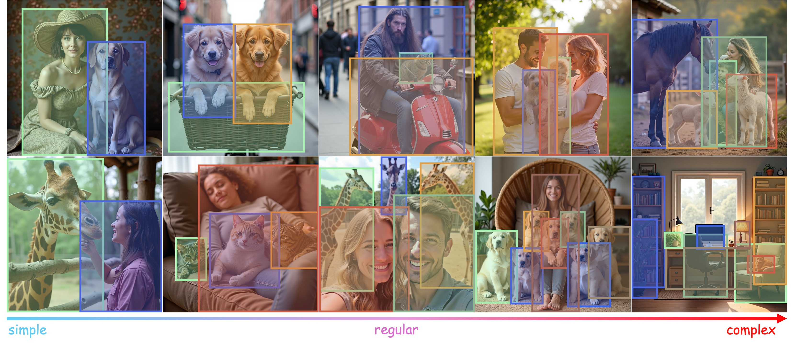

<h1 align="center">OverLayBench: A Benchmark
for Layout-to-Image Generation with Dense Overlaps</h1>


<p align="center">
    <a href="https://arxiv.org/abs/2509.19282" target="_blank">
        </a>
    <a href="https://mlpc-ucsd.github.io/OverLayBench/" target="_blank">
        </a>
    <a href="https://huggingface.co/datasets/cywang143/OverLayBench_Eval" target="_blank">
        </a>
</p>

<p align="center">
    <a href="https://www.bingnanli.com"><strong><ins>Bingnan Li <sup>1*</sup></ins></strong></a>
    ·
    <a href="https://www.linkedin.com/in/chenyu-wang-profile/"><strong><ins>Chen-Yu Wang <sup>1*</sup></ins></strong></a>
    ·
    <a href="https://xxuhaiyang.github.io"><strong><ins>Haiyang Xu <sup>1*</sup></ins></strong></a>
    ·
    <a href="https://xzhang.dev"><strong><ins>Xiang Zhang <sup>1</sup></ins></strong></a>
    ·
    <a href="https://scholar.google.com/citations?user=LE6bioEAAAAJ&hl=en"><strong><ins>Ethan Armand <sup>1</sup></ins></strong></a>
    ·
    <a href="https://scholar.google.com/citations?user=kw6DWjsAAAAJ&hl=en"><strong><ins>Divyansh Srivastava <sup>1</sup></ins></strong></a>
    ·
    <a href="https://shanxiaojun.github.io"><strong><ins>Xiaojun Shan <sup>1</sup></ins></strong></a>
    ·
    <a href="https://zeyuan-chen.com"><strong><ins>Zeyuan Chen <sup>1</sup></ins></strong></a>
    ·
    <a href="http://www.stat.ucla.edu/~jxie/"><strong><ins>Jianwen Xie <sup>2</sup></ins></strong></a>
    ·
    <a href="https://pages.ucsd.edu/~ztu/"><strong><ins>Zhuowen Tu <sup>1</sup></ins></strong></a>
</p>
<p align="center">
    <sup>1</sup>UC San Diego
    ·
    <sup>2</sup>Lambda, Inc.
</p>


<p align="center">
    Examples from <em>OverLayBench</em> with difficulty increasing from left to right.
</p>

## 📖 Abstract

>Despite steady progress in layout-to-image generation, current methods still struggle with layouts
containing significant overlap between bounding boxes. We identify two primary challenges: (1) large
overlapping regions and (2) overlapping instances with minimal semantic distinction. Through both
qualitative examples and quantitative analysis, we demonstrate how these factors degrade generation
quality. To systematically assess this issue, we introduce OverLayScore, a novel metric that
quantifies the complexity of overlapping bounding boxes. Our analysis reveals that existing
benchmarks are biased toward simpler cases with low OverLayScore values, limiting their
effectiveness in evaluating models under more challenging conditions. To reduce this gap, we present
OverLayBench, a new benchmark featuring balanced OverLayScore distributions and high-quality
annotations. As an initial step toward improved performance on complex overlaps, we also propose
CreatiLayout-AM, a model trained on a curated amodal mask dataset. Together, our contributions
establish a foundation for more robust layout-to-image generation under realistic and challenging
scenarios.

## 🔥 News

- **[2025-09-23]**: The preprint is available on [arXiv](https://arxiv.org/abs/2509.19282)!
- **[2025-09-19]**: OverLayBench is accepted by NeurIPS 2025 D&B Track! 🎉🎉🎉
- **[2024-06-17]**: The code and the evaluation toolkit are released!

## 🚀 Quick Start

### 🤖 Installation

`overlaybenchpytools` is a regular Python package (Python ≥ 3.9). The recommended setup uses
[vLLM](https://github.com/vllm-project/vllm) for the Qwen2.5-VL-32B judge:

```bash
pip install "overlaybenchpytools[all] @ git+https://github.com/mlpc-ucsd/OverLayBench.git"
# or from a clone
git clone https://github.com/mlpc-ucsd/OverLayBench.git
cd OverLayBench
pip install -e ".[all]"
```

`[all]` is `[vllm]`, which pins vLLM 0.8.5 and the transformers and qwen-vl-utils versions behind the reference numbers,
plus `[fid]` (pyiqa). Without vLLM, `pip install -e ".[fid]"` and `flash-attn` give the slower transformers judge
(`--backend hf`).

### 🧪 Evaluate Your Own Model!

Put the generated images in the following structure:
```
EXP_NAME
├── simple
│   ├── seed_1
│   │   ├── img_id_1.png
│   │   ├── img_id_2.png
│   │   └── ...
│   ├── seed_2
│   └── seed_3
├── medium
│   └── ...
└── hard
    └── ...
```

**Command line**

```bash
# every split and seed folder, all metrics, one judge engine on all visible GPUs
overlaybench-eval --root EXP_NAME --save-dir metrics/EXP_NAME

# CLIPScore and FID only: the judge is not loaded
overlaybench-eval --root EXP_NAME --metrics clip fid

# 8 GPUs as four judge engines with 2 GPUs each, the three judge tasks of a split in one pass
overlaybench-eval --root EXP_NAME --dp 4 --tp 2 --merge-judge-tasks \
    --gpu-memory-utilization 0.9 --vllm-arg max_model_len=32768
```

CLIPScore and FID of every split and seed are computed first; the judge is then loaded once for mIoU, O-mIoU, SR_E and
SR_R. `--resume` reuses the outputs already in `--save-dir`, so an interrupted run continues where it stopped. The run
ends with a table of mean ± std over seeds (also saved as `summary.json`). See `overlaybench-eval -h` for all options;
`python -m overlaybenchpytools` is the same command.

The judge takes almost all of the time. `--dp` runs several vLLM engines on disjoint GPUs and splits every split
between them. With 2 GPUs per engine, 48 GB GPUs need `max_model_len=32768` (the judge prompts are about 2k tokens) to
leave room for the KV cache. Judge time for OverLayBench-Regular (`medium`, 3,000 prompts) on RTX 6000 Ada (48 GB, PCIe);
with the last setup a full run (three splits, all metrics, one seed) takes 61 minutes:

| Judge setup | GPUs | Time |
|---|:---:|:---:|
| one engine, `--tp 4` (as the original toolkit) | 4 | 37 min |
| `--dp 2 --tp 4 --merge-judge-tasks` | 8 | 18 min |
| `--dp 4 --tp 2 --merge-judge-tasks` (see above) | 8 | 15 min |

**Python**

The original interface still works:

```python
from overlaybenchpytools import OverLayBenchMeter

if __name__ == "__main__":
    meter = OverLayBenchMeter(
        root='{YOUR_GENERATED_IMAGES_DIR}',
        extension='png', save_dir='./metrics',
        resolution=1024, bs_qwen="all", use_vllm=True,
        vllm_args={"tensor_parallel_size": 8})
    for split in ["simple", "medium", "hard"]:
        meter.set_split(split, '{YOUR SEED}')
        meter.evaluate()
```

`meter.run(splits, seeds)` does the same for every split and seed, CLIPScore and FID first. New keyword arguments:
`metrics` (any of `clip`, `fid`, `bbox` for mIoU/O-mIoU, `entity` for SR_E, `relation` for SR_R),
`data_parallel_size`, `merge_judge_tasks`, `num_workers`, `cache_dir`, `fid_args` and `resume`.
For the transformers judge, drop `use_vllm` and `vllm_args` and set `bs_qwen` to a batch size that fits.

`OverLayBenchMeter` covers `mIoU`, `Overlay mIoU (O-mIoU)`, `Entity Success Rate (SR_E)`, `Relationship Success Rate
(SR_R)`, `Global CLIPScore`, `Local CLIPScore` and `FID`. FID follows the clean-fid protocol of
[IQA-PyTorch](https://github.com/chaofengc/IQA-PyTorch) (InceptionV3) between the generated images of a split and its GT
images, which are exported from the dataset once; their features are cached in `cache_dir`
(default `$OVERLAYBENCH_CACHE` or `~/.cache/overlaybench`).

**Reproducibility.** CLIPScore and FID are bit-identical to the original toolkit, and the judge receives byte-identical
prompts and images. The judge outputs themselves are not bit-reproducible with vLLM: even two runs with the same
settings on the same GPUs disagree on 0.2–0.7% of the entity and relationship answers (OverLayBench-Regular), which
moves mIoU, O-mIoU, SR_E and SR_R by up to 0.3 points. The settings above stay within the same range: ten runs of
Regular with the original toolkit, the defaults, `--dp`, `--tp 2`, `--merge-judge-tasks` and other vLLM settings are all
within 0.4 points of each other on every metric.

The outputs are organized as follows:
```metrics
metrics
├── overlay_bench.log
├── summary.json                          # mean ± std over seeds (meter.run / overlaybench-eval)
├── simple
│   ├── seed_1
│   │   ├── baseline_bbox_predictions.json
│   │   ├── entity_VQA.json
│   │   ├── relation_VQA.json
│   │   ├── clip_score.json
│   │   ├── fid.json
│   │   └── results.json                  # all metrics of this split and seed
│   ├── seed_2
│   └── seed_3
├── medium
│   └── ...
└── hard
    └── ...
```


<p align="center">
Comparison of generated images from different models on <em>OverLayBench</em>.
</p>

## 🤝 Acknowledgements


We deeply appreciate the contributions of the following projects:

- [QWen2.5 VL](https://huggingface.co/collections/Qwen/qwen25-vl-6795ffac22b334a837c0f9a5)
- [Diffusers](https://github.com/huggingface/diffusers)
- [FLUX](https://github.com/black-forest-labs/flux)
- [IQA-PyTorch](https://github.com/chaofengc/IQA-PyTorch)
- [VLLM](https://github.com/vllm-project/vllm)
- [OpenCLIP](https://github.com/mlfoundations/open_clip)
## ✏️ Citation


```bibtex
@article{li2025overlaybench,
  title={OverLayBench: A Benchmark for Layout-to-Image Generation with Dense Overlaps},
  author={Li, Bingnan and Wang, Chen-Yu and Xu, Haiyang and Zhang, Xiang and Armand, Ethan and Srivastava, Divyansh and Shan, Xiaojun and Chen, Zeyuan and Xie, Jianwen and Tu, Zhuowen},
  journal={arXiv preprint arXiv:2509.19282},
  year={2025}
}
```
```bibtex
@inproceedings{NEURIPS2025_329ad516,
 author = {Li, Bingnan and Wang, Chen-Yu and Xu, Haiyang and Zhang, Xiang and Armand, Ethan and Srivastava, Divyansh and Xiaojun, Shan and Chen, Zeyuan and Xie, Jianwen and Tu, Zhuowen},
 booktitle = {Advances in Neural Information Processing Systems},
 editor = {D. Belgrave and C. Zhang and H. Lin and R. Pascanu and P. Koniusz and M. Ghassemi and N. Chen},
 pages = {},
 publisher = {Curran Associates, Inc.},
 title = {OverLayBench: A Benchmark for Layout-to-Image Generation with Dense Overlaps},
 url = {https://proceedings.neurips.cc/paper_files/paper/2025/file/329ad516cf7a6ac306f29882e9c77558-Paper-Datasets_and_Benchmarks_Track.pdf},
 volume = {38},
 year = {2025}
}

```
